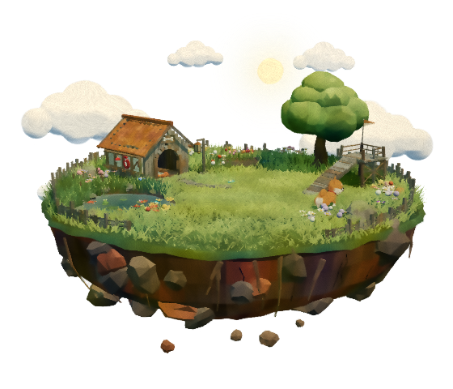

# 柴犬小岛 · 3D 桌宠

一只小柴犬住在悬浮的田园小岛上，小岛漂在你的桌面上。岛上的时间跟随电脑时钟，有昼夜、阴晴雷雨和晚霞；小狗会自己玩，也可以陪你玩。



## 能做什么

**小狗自己的生活**

- 晴天在草坪上奔跑、打滚、追蝴蝶，下雨和夜里回狗窝。
- 去池塘喝水，把垫子从狗窝里叼出来晒太阳，爬上瞭望台眺望。
- 作息跟着电脑时钟走：6:30 起床伸懒腰，早晚各吃一顿饭，清晨和傍晚最活跃，中午午睡，晚上在窝门口歇着，22:00 回窝睡觉。
- 蝴蝶、熊蜂、蜻蜓、萤火虫按昼夜和天气出现；池塘里有金鱼、青蛙和螃蟹。
- 白天 8:00–18:00 会有白鹭飞来岛边停留一会儿（晴天 5 次、阴天 3 次、雨天不来）。小狗偶尔会趴到白鹭背上出门旅行，18:00 被驮回来；出门期间画面顶部有提示，可以点“叫它回来”。

**和小狗互动**

狗窝外墙上有一排玩具架，点架子上的物品开始对应的玩法：

| 物品 | 玩法 |
| --- | --- |
| 树枝 | 小狗兴奋转圈，再点一下把树枝扔出去，它会捡回来。鼠标静止 10 秒或移出画面则结束。 |
| 遛狗绳 | 第一视角遛狗小游戏：手带动绳子、绳子带动小狗，躲避障碍，一局 3 分钟，难度递增。 |
| 钓鱼 | 尾巴钓鱼小游戏：小狗背对池塘把尾巴垂进水里，一局 6 钩，咬钩后提竿、拉扯。 |

把鼠标移到小狗身上会变成一只小手，在它身上滑动就是摸摸小狗，它会停下来享受、摇尾巴或翻肚皮。

**窗口操作**

| 操作 | 效果 |
| --- | --- |
| 左键拖动画面 | 移动窗口 |
| 拖右下角手柄 | 缩放窗口；窗口较小时只显示小岛，背景透明 |
| 滚轮 | 以鼠标位置为中心放大、缩小视角 |
| 右键拖动 | 旋转、俯仰视角 |
| 中键 | 视角复位 |
| 托盘图标 | 退出桌宠 |

透明区域的点击会穿透到桌面上的其他窗口。

## 运行

需要 Node.js 18 或更高版本。目前只在 Windows 上打包和验证过。

```bash
npm install
```

```bash
npm run pet
```

Windows 下也可以直接双击 `启动桌宠.bat`，它会在缺少依赖时先安装再启动。

只想在浏览器里看画面：

```bash
npm run dev
```

## 打包成单文件 exe

```bash
npm run dist
```

产物在 `release/柴犬小岛.exe`，是免安装的单文件，双击即可运行。没有代码签名，首次运行时 Windows 可能提示“未知发布者”。

## 调试参数

浏览器里在地址后加查询参数；桌宠用 `--query="..."` 传入同样的参数。

| 参数 | 取值 | 说明 |
| --- | --- | --- |
| `hour` | 0–24 | 固定岛上时间，不写则跟随系统时间 |
| `weather` | `clear` / `cloudy` / `rain` / `storm` | 固定天气，不写则自动变化 |
| `timescale` | 数字 | 时间流速倍率 |
| `seed` | 整数 | 随机种子 |
| `brain` | `off` | 关闭小狗的自主行为 |
| `action` | 动作名 | 让小狗固定做某个动作 |
| `focus` | `dog` / `kennel` / `lawn` | 镜头对准的位置 |
| `fx` | `0` | 关闭手绘后处理 |
| `fps` | `30` / `60` | 强制帧率，不写则自适应 |
| `backdrop` | `0` / `1` | 始终只显示小岛 / 始终显示完整画面 |
| `game` | `walk` / `fishing` | 启动后直接进入遛狗 / 钓鱼 |

## 测试

```bash
npm run smoke
```

```bash
npm run behavior
```

```bash
node scripts/walk-test.mjs
```

```bash
node scripts/fish-test.mjs
```

```bash
node scripts/pondlife-test.mjs
```

截图工具（在隐藏窗口里渲染并保存 PNG）：

```bash
npm run shot -- --out shots/a.png --query "hour=18.2&weather=clear"
```

## 技术说明

- **渲染**：three.js（WebGL），所有模型都是程序化生成，使用顶点色，没有外部美术素材。
- **画风**：水粉手绘质感的材质，加一层全屏 Kuwahara 后处理。
- **小狗**：26 根骨骼的蒙皮网格，动作由姿态参数函数生成并做交叉淡入。
- **外壳**：Electron 透明无边框置顶窗口，Vite 构建，electron-builder 打包。

目录结构：

```
src/
  core/         环境（时间、天气）、参数、手绘材质、模块装配
  world/        小岛、天空、昆虫
  dog/          小狗模型与行为
  interaction/  树枝、摸摸小狗
  minigame/     遛狗、钓鱼
  render/       后处理
  ui/           时间天气面板
electron/       桌面外壳
scripts/        测试与截图工具
docs/DESIGN.md  设计方案与各模块的验收标准
```

## 尚未完成

- 小游戏的奖励机制只留了接口，结算结果还没有用处。
- 钓鱼的图鉴界面没做，只记录了数据。
- 漂流瓶里的寄语是占位文案，在 `src/core/messages.js`。
- 青蛙、螃蟹和小狗之间还没有日常互动。
- 没有音效。
